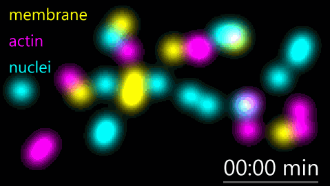
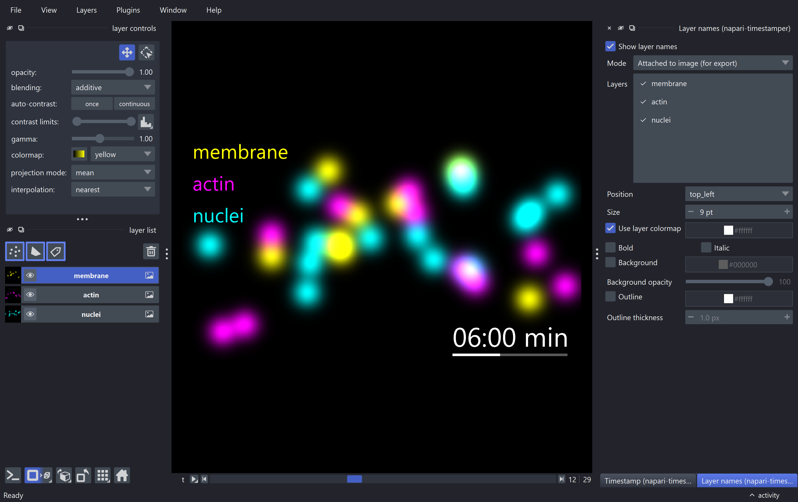
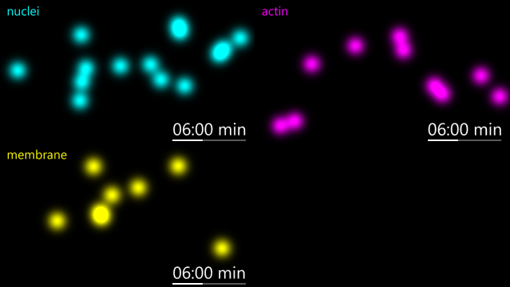

# napari-timestamper

[](https://github.com/bgraedel/napari-timestamper/raw/main/LICENSE)
[](https://pypi.org/project/napari-timestamper)
[](https://python.org)
[](https://github.com/bgraedel/napari-timestamper/actions)
[](https://codecov.io/gh/bgraedel/napari-timestamper)
<!-- [](https://napari-hub.org/plugins/napari-timestamper) -->

Label [napari] views with timestamps and layer names, and export them as
images or movies.



## Features

All widgets are under **Plugins › Timestamper**.

| Widget | What it does |
|---|---|
| **Timestamp** | Time label in formats such as `HH:MM:SS` or `MM:SS.ss`, with a start offset (negative times allowed), prefix/suffix and live preview. **From data** reads the frame interval from the layers' time scale and units, e.g. `scale=(0.5, 1, 1), units=("min", "um", "um")` gives 30 s. **Show on** picks the layers it is drawn on. Optional **time bar**, like Fiji's *Time Bar*: a progress bar as wide as the time, directly under it. |
| **Layer names** | Labels each layer with its name, in the layer's colormap color (the same rule napari uses) or a fixed color. Choose which layers get a label. |
| **Export (image / movie)** | Renders the view, including all labels, along a slider axis to mp4 (H.264), gif, tif or a png/jpeg series. Frame range, frame rate, upscaling and a cancellable progress dialog. |
| **Convert to RGB layer** | Renders selected layers into a new RGB layer. |
| **Split stack** | Splits a layer along an axis into separate layers. |



### Display modes

Timestamps and layer names have two modes:

- **Attached to image (for export)**: drawn inside the layer and scaled with
  it, so an export looks the same regardless of zoom, export size or screen.
  Supports bold/italic, outlines and offsets.
- **Fixed on screen**: napari's own text overlays, at a constant screen size
  and tiled with the scale bar and other canvas overlays.

Both modes support backgrounds and the time bar.

### Grid mode

In grid mode every layer gets its own label, and the timestamp is drawn on
every checked layer. Without grid mode it is drawn once, on the topmost
checked layer.



### Scripting

```python
from napari_timestamper import TimestampManager, render_as_rgb, save_image_stack

ts = TimestampManager(viewer, step_size=30, time_format="MM:SS", suffix="min",
                      show_bar=True)
ts.visible = True
frames = render_as_rgb(viewer, axis=0)
save_image_stack(frames, "exports", "movie", "mp4", fps=10)
```

`LayerAnnotatorManager` works the same way for layer names.

## Installation

Install from napari's plugin manager (**Plugins › Install/Uninstall Plugins**),
or with [pip]:

    pip install napari-timestamper

Latest development version:

    pip install git+https://github.com/bgraedel/napari-timestamper.git

Requires napari ≥ 0.10 and Python ≥ 3.11. For older napari versions use
`napari-timestamper<0.7`.

The labels build on napari's private vispy overlay API, so new napari
releases may need a plugin update.

## What's new in 0.7

- Support for napari 0.10 (the Timestamp widget broke with napari 0.9) and
  Python 3.11-3.14.
- New **fixed on screen** mode using napari's native overlays.
- Fiji-style time bar.
- The timestamp can be placed on chosen layers.
- **From data**: frame interval read from the layer scale and units.
- Export with frame range, cancel button and mp4 out of the box.
- Label sizes no longer depend on the screen's DPI.

## Contributing

Contributions are very welcome. Tests can be run with [tox]; please make
sure the coverage at least stays the same before you submit a pull request.

## License

Distributed under the terms of the [BSD-3] license, "napari-timestamper" is
free and open source software.

## Issues

If you encounter any problems, please [file an issue] along with a detailed
description.

[napari]: https://github.com/napari/napari
[BSD-3]: http://opensource.org/licenses/BSD-3-Clause
[file an issue]: https://github.com/bgraedel/napari-timestamper/issues
[tox]: https://tox.readthedocs.io/en/latest/
[pip]: https://pypi.org/project/pip/
